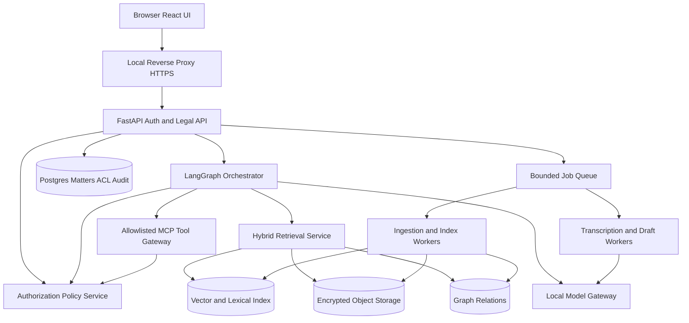

# 05 — System architecture and data flows
## Architectural style
Modular monolith first, with separable inference and indexing workers: easier to secure, backup and operate on a single on-prem DGX Spark than dozens of microservices. Existing EchoMind FastAPI services may be retained; new legal-specific modules should be isolated by API contracts. All production traffic remains local.

## Services and responsibilities
1. `ui` React+Vite, local assets, trusted component registry, authenticated session; client does not hold source-of-truth access policy.
2. `api` FastAPI, typed endpoints, REST/SSE/WS auth, idempotency, audit, matter policy, citation signing.
3. `auth-policy` local session and group membership plus ABAC rules; matter/ethical wall checks at DB/RAG/graph/tool/storage boundaries. Can be module within API.
4. `ingest-worker` immutable original ingestion, malware scanning if available, format detection, sandboxed extraction, page structure, chunk/source map, indexing, entity proposals.
5. `retrieval` per-matter lexical and vector index, ACL prefilter, rerank, exact quote verifier, full source resolver; no cross-matter implicit synthesis.
6. `model-gateway` TensorRT-LLM serving (existing), queue admission, model loading, request cancellation, schema-constrained generation where feasible.
7. `orchestration` LangGraph states/checkpoints, approval interrupt, tool invocation, council optional. Keep durable state matter-scoped.
8. `speech` opt-in WebSocket live STT, optional local diarization/batch accuracy pass, explicit retention.
9. `storage` Postgres transactional system of record; encrypted originals/drafts; pgvector or current index reused; graph in Postgres initially.
10. `jobs` bounded queue with live-recording priority; model-heavy jobs serialized when required.
11. `backup-agent` tested encrypted snapshot with point-in-time metadata and periodic restore verification; no reliance on cloud.

## Boundary: retrieval never returns unrestricted objects
- Every request has verified identity, tenant, matter, authorization epoch, correlation ID.
- Query builder constructs **tenant + allowed matter IDs + document ACL + ethical wall constraints** at candidate-selection time; same for graph edges and keyword index.
- Cache keys include tenant, policy epoch, user authorization scope, matter, model/index version; on permission change invalidate.
- Object open performs a separate authorization check; signed references short-lived and bound to user/session/matter.
- Extracted text is untrusted: instruction firewall separates text content from tool/system instructions.

## Ingestion state machine
`uploaded -> queued -> scanning -> parsing -> chunking -> embedding -> indexed -> quality_checked -> available` with terminal `failed/quarantined/canceled`. Original bytes never mutated. For scanned PDFs, OCR derived text version has provenance and confidence; expose uncertain OCR rather than manufacturing content.

## Answer state machine
`requested -> authenticated -> authorized -> retrieved -> reranked -> verified -> answered -> component-rendered` or `abstained/error`. For streaming, text may arrive before cards, but citations remain `pending` until verified.

## Workflow durability
Use checkpoint records for LangGraph tied to matter+request. Side effects through idempotent approved tools only. Store minimal sensitive state; encrypt persisted traces; avoid logging full privileged text by default.

## Observability (local only)
Prometheus-like local metrics, structured redacted logs, per-job timings, queue depth, token/s, memory, STT lag, retrieval recall tests, failure counts. Offline crash reporting disabled unless explicitly exported by firm policy.

## Deployment topology
Nginx/Caddy local TLS -> React static + API; Postgres; object storage path; model server; ingestion worker; optional STT. Docker Compose ARM64 base is sufficient initially; Kubernetes is unnecessary without measured need. Use least-privilege volumes and internal service network; no exposed databases.
